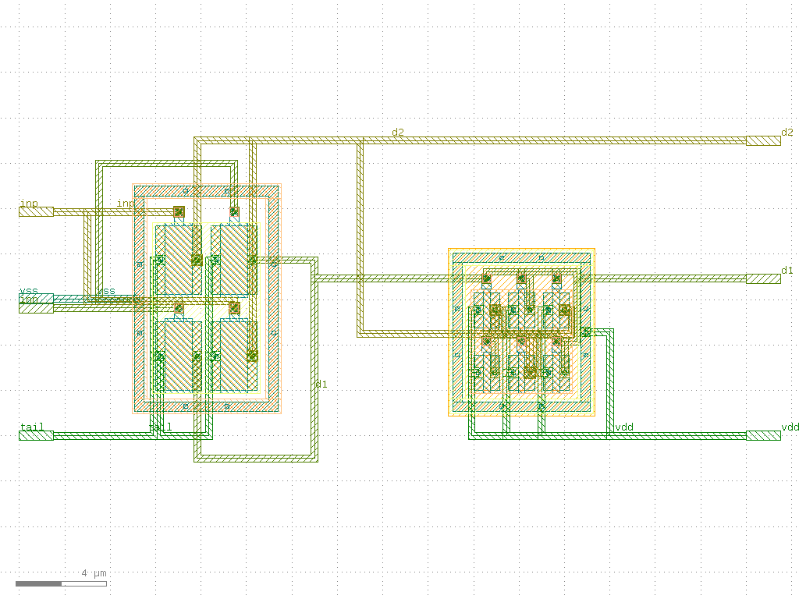

# layout/opamp_stage1: first-stage matched groups (input pair + PMOS mirror)

This is the first layout sub-block of `opamp_core` (issues #46 and #121). It
holds the NMOS differential input pair `XM1`/`XM2` and the PMOS current
mirror `XM3`/`XM4` from `design/netlist/opamp_core.spice`:

| Device | Model | Netlist W / L | Drawn as |
|---|---|---|---|
| `XM1`, `XM2` | `sky130_fd_pr__nfet_01v8` | 6.03 / 1.2 um | 2 x 3.015 um units each |
| `XM3`, `XM4` | `sky130_fd_pr__pfet_01v8` | 4.635 / 0.3 um | 3 x 1.545 um units each |

It is DRC clean on klt's curated sky130 deck and on the PDK's own Magic
`drc(full)` deck. It LVS matches a reference generated from the netlist's own
device cards, in both `klt lvs` and netgen, with all seven boundary pins
(`inn inp tail d1 d2 vdd vss`) compared and equivalent.

## Scope

This is the first-stage sub-block only. It is not the op-amp's layout: the
bias/tail mirror, the output stage, the compensation network (`opamp_comp/`
is a separate, unjoined cell) and the cross-block routing are not here. T1
item 2 stays `unmet` and no manifest cites this directory. Parasitics are
not extracted, so nothing here says the matching survives routing (see
[Routing and pins](#routing-and-pins)).

The PMOS width is the grid-legal `W=4.635 um` of
[DR-013](../../spec/decision-records/DR-013-grid-legal-mos-widths.md)
(the earlier 4.634 um was off the 0.005 um manufacturing grid, which blocked
the mirror in #46). DR-013 allows a three-way 1.545 um split and rejects an
equal two-way 2.3175 um split, which would be off-grid again.

## Result

| Step | Result | Evidence |
|---|---|---|
| `klt drc --deck sky130` | `status: "clean"`, `violation_count: 0` | `drc.json` |
| `klt extract --deck sky130` | `extracted`: 10 units (4 nfet, 6 pfet), 7 nets | `extract.json`, `opamp_stage1.spice` |
| `klt lvs` (subckt-call reference, `combine_devices`) | `status: "match"`: devices 4/4, nets 7/7, pins 7/7, `mismatch_count: 0`, `error_count: 0` | `lvs.json` |
| LVS negative control (`XM1` gate `inn` -> `inp`, scratch four-device reference) | `status: "mismatch"`, `mismatch_count: 1` (`device.unmatched`, `XM1`), devices 3/4 and nets 3/7 matched, pins 7/7 | `negative-control/` |
| `compose-cell.py --check` | the rebuild is byte-identical: SHA-256 of `opamp_stage1.gds` and all 10 `gen/*.gds`, the generated reference text, and the verdict fields | run it |
| Magic 8.3.683 `drc(full)`, `sky130A.tech` | **0 errors**; types seen: `nwell pwell nmos pmos ndiff pdiff ndiffc pdiffc psubdiff nsubdiff psubdiffcont nsubdiffcont poly polycont locali viali metal1-3 via1-2` | `magic-signoff/magic.json` |
| netgen 1.5.133 + `sky130A_setup.tcl` (Magic extraction vs. the same reference) | `Netlists match uniquely.`; `Cell pin lists are equivalent.` for `inn inp tail d1 d2 vdd vss` (`port makeall` promotes the pin labels to ports before extraction) | `magic-signoff/netgen.out` |

`cell.json` `expect.magic_types` lists `nmos pmos ndiff pdiff psubdiff
nsubdiff nwell poly`, so `magic-signoff.py` fails if either the NMOS or the
PMOS/well geometry is missing from Magic's view of the GDS (its fallback set
is NMOS-only and would not prove the mirror exists).

Toolchain: klt `0.7.0+g4cbdfa769875` (git `4cbdfa76`), KLayout 0.30.12,
sky130A open_pdks `c6d73a35f524070e85faff4a6a9eef49553ebc2b`, klt deck
`sky130`. Top-cell GDS SHA-256:
`530a21f8fee6c2da54427f576375426a5bb66f4490d055aab76dc85e3bb29033`.
All commands were run with klt installed into a throwaway venv from
`git+https://github.com/2AMLogic/klayout-tools@4cbdfa76`, not the host
install.

### Extracted devices against the netlist

| Netlist card | Extracted units (d / g / s / b) | Unit W x L | Total W |
|---|---|---|---|
| `XM1 d1 inn tail vss ... L=1.2 W=6.03` | `$1`, `$4`: d1 / inn / tail / vss | 3.015 x 1.2 | 6.03 |
| `XM2 d2 inp tail vss ... L=1.2 W=6.03` | `$2`, `$3`: d2 / inp / tail / vss | 3.015 x 1.2 | 6.03 |
| `XM3 d1 d1 vdd vdd ... L=0.3 W=4.635` | `$5`, `$7`, `$9`: d1 / d1 / vdd / vdd | 1.545 x 0.3 | 4.635 |
| `XM4 d2 d1 vdd vdd ... L=0.3 W=4.635` | `$6`, `$8`, `$10`: d2 / d1 / vdd / vdd | 1.545 x 0.3 | 4.635 |

The raw extraction reports 10 unit devices (`expect.extracted_devices`:
4 + 6), which `options.combine_devices` merges into the four schematic
device groups of the LVS (4/4). The driver checks the grouping itself: it
groups extracted units by terminal nets and requires each group's summed W
and common L to equal the card's W and L exactly, and it rejects any
extracted device that matches no card. `klt lvs` compares W exactly too. As a
probe on the earlier input-pair-only cell, a scratch reference at W=6.031,
6.035, 6.04 or 6.1 returned `mismatch` every time; that probe was not re-run
for the mirror.

### DRC coverage (quoted from `drc.json` `coverage`)

- `known: true`, `nothing_checked: false`, `unknown: []`, `skipped: []`.
- **65 rules checked**: `diff`/`tap`/`poly`/`licon1`/`li1`/`mcon`/`met1`/
  `via`/`met2`/`via2`/`met3` width, spacing (li1, mcon, met1-3, via, via2),
  enclosure, area, holes-area, angle and `*.ongrid.1`, plus
  `nsdm`/`psdm`/`npc` angle and on-grid checks and (new with the mirror)
  `nwell` width, space, angle and on-grid.
- **71 rules `inapplicable`** (`no_applicable_geometry`), including
  `dnwell.*`, `met4`/`met5`, `via3`/`via4` and capm rules.
- `layers_checked`: `64/20 65/20 65/44 66/20 66/44 67/20 67/44 68/20 68/44
  69/20 69/44 70/20 93/44 94/20 95/20`.
- `layers_in_stream_without_rules`: `67/5 68/5 69/5 70/5`, the pin-label
  text layers.

**What the curated deck cannot see, and why there is a second deck.** The
curated deck has no implant-enclosure, `npc`-enclosure, poly-endcap
(`poly.8`), poly-to-diffusion spacing (`poly.4`), diffusion-extension
(`poly.7`) or n-tap/well-overlap (`diff/tap.10`) rules, and the klt
generators draw none of the implant/endcap features on sky130. A first composition without the
`fe_masks` overlay (below) was `clean` on klt's deck and LVS `match`. On
Magic `drc(full)` the same GDS gave 12 error sites: `poly.8` at every gate
end, plus `nwell`/`diff/tap.8`/`LU.3`/`poly.7`. Those arise because Magic
reads implant-less diffusion as p-diffusion and the devices as `pmos`.
netgen did not match. That probe was a scratch run and is not committed;
re-run it with `magic-signoff.py` on a copy of `cell.json` without the
`fe_masks` block. `layout/bin/magic-signoff.py` makes the PDK's Magic deck
a second, independent check of the committed GDS. Before it trusts a zero
error count, it requires Magic to see the types in `cell.json` `expect.magic_types`
(`nmos pmos ndiff pdiff psubdiff nsubdiff nwell poly`). Magic's
`gds flatglob` was found to produce an empty top cell on these streams, a
vacuous pass the guard exists to catch.

Neither deck is a substitute for a foundry signoff run. Magic `drc(full)` is
the open_pdks reference deck, but antenna, density and latch-up rules at
chip level are out of scope for a sub-block.

## Matching style and placement

### NMOS input pair `XM1`/`XM2` (block `mn12`)

One `klt gen diff_pair` block (`splits: 2`, `gate_contact: true`,
`add_guard_ring: true`). The units form a 2 x 2 common-centroid
cross-quad. Coordinates are in um, in the cell frame:

```
            col 0 (diff x 0..2.04)    col 1 (diff x 2.44..4.48)
 row 1      XM2 unit (Q2_2)           XM1 unit (Q1_2)        diff y 4.235..7.25, gate pads y 7.86
 row 0      XM1 unit (Q1_1)           XM2 unit (Q2_1)        diff y 0..3.015,    gate pads y 3.625
            S x=0.21 D x=1.83          S x=2.65 D x=4.27     gates x 0.42..1.62 / 2.86..4.06 (L=1.2)
```



- **Common centroid.** Each device's two units sit on opposite diagonals,
  so both devices have their centroid at the array centre in x and y. A
  linear process gradient in either direction cancels to first order.
- **Same orientation.** All four units are drawn identically, with no
  mirroring: source on the west, drain on the east, gate pad on the north,
  in every unit. Gate shadowing and tilt-implant asymmetry are common to
  both devices.
- **Equal length and unit count.** Both devices are 2 units of
  3.015 x 1.2 um, which follows DR-002/DR-007's rule that matched devices
  share one length and differ only in unit count. Here the counts are equal.
- **Guard ring and taps.** The generator's p-tap ring encloses the quad
  with a 0.5 um padding (outer box -0.92..5.40 x -0.92..8.99). Its four taps
  form one ring conductor, strapped on li1 from `TAP_W` to the `vss` pin.
  That ring is the substrate/body contact, and every unit's body extracts
  as `vss`. Magic reads it as `psubdiff`/`psubdiffcont`.
- **Front-end masks (`fe_masks`, one `klt draw` overlay in the pair's own
  frame):**
  - `nsdm` over all four diffusions, with 0.125 um enclosure.
  - A `psdm` ring over the tap ring, with 0.125 um enclosure.
  - `npc` over each gate licon, with 0.1 um enclosure.
  - 0.15 um poly endcaps along the full gate width at both ends of every
    gate. sky130 `poly.8` requires 0.13 um.

  The overlay is symmetric over the four units, so it does not bias the
  match.
- **No dummies.** `diff_pair` has no dummy-device option. The outer units
  see the guard ring, not an identical neighbour, on their outer sides.
  The ring is symmetric about the array centre, so this is common to both
  devices, but the edge units are not shielded the way dummy columns would
  shield them.

### PMOS mirror `XM3`/`XM4` (block `mp34`)

Six 1.545 x 0.3 um units in a 2 x 3 checkerboard, three per device
(3 x 1.545 = 4.635, DR-013's grid-legal split). Coordinates are in um, in the
block's own frame (placed at x=14 in the cell frame):

```
            col 0 (diff x 0..1.14)  col 1 (1.54..2.68)   col 2 (3.08..4.22)
 row 1      XM4 (Q2_2)              XM3 (Q1_3)           XM4 (Q2_3)      diff y 2.765..4.31, gate pads y 4.92
 row 0      XM3 (Q1_1)              XM4 (Q2_1)           XM3 (Q1_2)      diff y 0..1.545,    gate pads y 2.155
            S x=0.21 D x=0.93       S x=1.75 D x=2.47    S x=3.29 D x=4.01   gates 0.3 wide, x 0.42 / 1.96 / 3.5
```

- **Matching style.** Interleaved checkerboard with an odd split. Both
  devices have the same three-unit count and the same orientation (source
  west, drain east, gate pad north, no mirroring). Their x-centroids
  coincide (both at the array centre, x=2.11). Their y-centroids do **not**
  coincide: `XM3` has two units in row 0 and one in row 1 (y-centroid
  1/3 of the row pitch), `XM4` the reverse (2/3). An odd split cannot cancel
  a y-gradient to first order the way the pair's 2 x 2 quad does; the
  residual is one third of the row pitch (0.92 um, centroids at y=1.69 and
  y=2.62) between the two devices. Grid-legal alternatives with the same
  1.545 um unit have the same limit, and a single 4.635 um unit per device
  would not interleave at all.
- **Not the NMOS pair's two-way split.** An equal two-way split
  (2 x 2.3175 um) is off the 0.005 um grid (DR-013). `XM3`'s drains and
  all six gates share `d1` (the diode connection); `XM4`'s drains are `d2`.
- **Guard ring and well.** An n-tap ring (0.5 um padding, 0.42 um thick,
  li1 + tap + licon) encloses the array; every unit body extracts as `vdd`.
  The nwell extends 0.2 um beyond the ring.
- **Masks drawn in the block.** `psdm` over the p-diffusions, an `nsdm`
  ring over the n-tap ring (0.125 um enclosure each), `npc` over each gate
  licon, and 0.15 um poly endcaps (`poly.8` needs 0.13 um).
- **No dummies.** As for the pair, the outer units see the ring instead
  of an identical neighbour.

**Why this block is drawn with `klt draw`, not `klt gen`.** `klt gen
diff_pair` (`flavor: "pfet"`, `splits: 3`, W=1.545, L=0.3) was tried first.
Its gate landing pad is 0.42 um wide, wider than the 0.3 um gate, and
starts exactly at the diffusion edge. After adding the missing implants and
endcaps, DRC was clean on klt's deck and LVS matched, but Magic `drc(full)`
reported 24 `poly.4` sites (poly spacing to diffusion < 0.075 um) at the
pads and 56 `diff/tap.10` sites (the generator's well overlaps the n-tap
ring by 0.15 um, 0.18 um is needed). Those were scratch runs, not
committed. `mp34` reproduces the generator's geometry (diffusion, S/D li1
and licons, tap ring, port positions on the 0.005 um grid) but starts each
gate pad 0.15 um clear of the diffusion and extends the well to 0.2 um. The
shape list is in `cell.json` (`blocks[id=mp34].draw`). Filed as
2AMLogic/klayout-tools#3115.

### Routing and pins

The NMOS cross-quad's two diagonals make `d1`/`d2` and `inn`/`inp`
inherently crossing pairs, so each pair is split across two routing planes.
The mirror sits 14 um east of the pair and is joined to it by `d1`/`d2`:

| Net | Plane | Path |
|---|---|---|
| `tail` | met1 | vertical strap on each NMOS source column (x=0.21, x=2.65) through both rows, joined below the ring at y=-2.0 |
| `d1` | met2 | `XM1` row-0 drain south to y=-3.0, east to x=7.0, north to y=4.92 and east into the PMOS row-1 gate bus (y=4.92); the row-1 `XM1` drain joins the same trunk. In the mirror: gate buses at y=2.155 (row 0) and y=4.92 (row 1) joined by an east trunk at x=18.55, each `XM3` drain stubbed to its bus, then east at y=4.92 to the pin |
| `d2` | met3 | both `XM2` drains north to y=11.0, east to the pin; a branch down x=9.0 to y=2.5 and east into a met3 bus joining the three `XM4` drains |
| `inn` | met2 | inner gate west to x=-2.5, north to y=10.0, east and down to the outer gate |
| `inp` | met3 | inner gate west to x=-3.0, north to the outer gate's track (y=7.86) |
| `vss` | li1 | NMOS `TAP_W` west to the pin |
| `vdd` | met1 | a strap on each PMOS source column (x=0.21, 1.75, 3.29 in the block frame) through both rows; row-0 sources joined below the ring at y=-2.0 and to the ring tap `TAP_E` by a vertical at x=20.0 (cell frame); the pin hangs off the y=-2.0 bus |

`vdd` stays on met1 because a met3 source strap cannot sit beside a met3
`d2` drain: the S and D pads are 0.72 um apart and `met3.space.1` needs
0.3 um between two nets' 0.49 um pads (the router rejected it). The
three nets that cross in the mirror therefore sit on three planes:
`vdd` met1, `d1` met2, `d2` met3.

Every boundary net ends on a `klt draw` stub (1.5 x 0.42 um on the net's
own routing layer) at the cell edge. Its `PAD` is promoted through
`pins[]`. West edge: `tail`, `inn`, `vss`, `inp`. East edge (x=26): `d1`,
`d2`, `vdd`. `compose.response.json` `ports[]` lists exactly
`inn inp tail vss d1 d2 vdd`; the driver fails if any LVS pin is not a
composed-cell port or is not a named net in the extraction. Each label
sits on its stub's own metal (`67/5`/`68/5`/`69/5`/`70/5`), and `klt
extract` recovers all seven net names from them. Magic/netgen compare the
same seven pins.

**The routing is not symmetric.** Only the devices are matched. `d1`
loops south and east while `d2` runs north; the two gate routes have
different lengths and layers; in the mirror `d1` is on met2 and `d2` on
met3, and the `XM3`/`XM4` drain buses have different lengths. The two
halves therefore see unequal wiring capacitance and resistance. LVS cannot
see that. Parasitic extraction of this block (out of scope here) is the
check that would quantify it. A symmetric two-plane trunk is a candidate
improvement.

## klt gaps hit (friction protocol)

| Gap | Filed | Effect here / workaround |
|---|---|---|
| `gen-compose` centres via-drop stacks on off-grid port midpoints (odd-grid-multiple pads) | 2AMLogic/klayout-tools#2932 | The first compose had 134 findings (133 `*.ongrid.1`). `snap_ports_to_grid_um: 0.005` moves each attach point at most 0.0025 um, inside its own pad. Moves are recorded in `gen/mn12.snapped.gen.json` `_snapped_ports`, and the unmodified report stays in `gen/mn12.gen.json`. |
| `gen` silently accepts a `w_um` not representable on the grid | 2AMLogic/klayout-tools#2933 | This is why the old W=4.634 could not be drawn (#46); DR-013's 4.635 um is on-grid, so it no longer applies here. |
| sky130 generators draw no `nsdm`/`psdm`/`npc`, and the curated deck can't see it | 2AMLogic/klayout-tools#2934 | Drawn by hand in `fe_masks`. Checked with Magic. |
| sky130 unit-device gate poly has no endcap (`poly.8`), and the curated deck can't see it | 2AMLogic/klayout-tools#2936 | Endcaps drawn in `fe_masks`. Checked with Magic. |
| sky130 `diff_pair` gate landing pad (0.42 um) abuts the diffusion when L < 0.42 um (`poly.4`), and the pfet guard-ring well overlaps the n-tap by 0.15 um (`diff/tap.10`); neither is in the curated deck | 2AMLogic/klayout-tools#3115 | The mirror block `mp34` is drawn with `klt draw` from the generator's geometry with those two fixes (see "PMOS mirror"). Checked with Magic. |
| `gen-compose` response records `blocks[].cell` `source_path` as absolute | 2AMLogic/klayout-tools#2935 | The driver strips the output-directory prefix before writing `compose.response.json`. |

## Reproduce

```
python3 layout/bin/compose-cell.py layout/opamp_stage1/cell.json            # regenerate in place
python3 layout/bin/compose-cell.py layout/opamp_stage1/cell.json --check    # byte-exact rebuild check
python3 layout/bin/compose-cell.py layout/opamp_stage1/cell.json --negative-control XM1:g=inp
python3 layout/bin/magic-signoff.py layout/opamp_stage1/cell.json           # Magic DRC + netgen LVS
```

See `layout/README.md` for the pinned toolchain and a throwaway-venv
recipe.

## Files

- `cell.json` is the recipe: blocks (`mn12` generated, `fe_masks` and
  `mp34` drawn), placement, routing, pins and the LVS device selection.
- `gen/`: per-block `klt gen`/`klt draw` requests, responses and streams.
- `compose.request.json`, `compose.response.json`: `klt gen-compose`.
- `opamp_stage1.gds` is the composed cell (GDS timestamps are zero).
- `drc.json`, `extract.json`, `opamp_stage1.spice`: klt DRC report,
  extraction report and extracted netlist.
- `opamp_stage1.ref.spice` is the generated LVS reference (cards `XM1`
  to `XM4` copied verbatim from `design/netlist/opamp_core.spice`).
- `lvs.request.json`, `lvs.json`: the passing klt LVS run.
- `negative-control/`: the scratch four-device reference with one gate rewired, its
  request and the `mismatch` response. It never overwrites the files above.
- `magic-signoff/`: Magic DRC/extraction summary (`magic.json`), the
  Magic-extracted netlist and the netgen report.
- `overview.png`: `klt render` overview, for orientation only (not part of
  `--check`).
